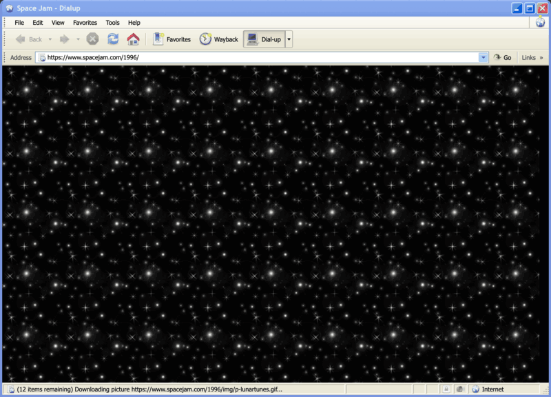

<h1 align="center"><a href="https://viktorfroberg.github.io/Dialup/"></a><br>Dialup</h1>

<p align="center"><b><a href="https://viktorfroberg.github.io/Dialup/">Website</a></b> · <a href="https://github.com/viktorfroberg/Dialup/releases/latest/download/Dialup.zip">Download</a> · <a href="https://github.com/viktorfroberg/Dialup/releases/latest">What's new</a></p>

<p align="center">
  <a href="https://github.com/viktorfroberg/Dialup/releases/latest/download/Dialup.zip"></a>
  <a href="https://viktorfroberg.github.io/Dialup/"></a>
  <a href="LICENSE"></a>
  
</p>

<p align="center">
  <a href="https://github.com/viktorfroberg/Dialup/actions/workflows/ci.yml"></a>
</p>

Dialup is a fast, free web browser for your Mac. Browse in tabs, leave the ads behind and dress the whole browser in the skin you like best: Luna, Aqua or Classic. It runs on the same engine as Safari, so the Web just works.

<p align="center">
  
</p>

## Download

**[⬇ Download Dialup](https://github.com/viktorfroberg/Dialup/releases/latest/download/Dialup.zip)** for macOS 15.4 or later (Apple silicon and Intel). Or install from Terminal, without the security warning:

```sh
curl -fsSL https://raw.githubusercontent.com/viktorfroberg/Dialup/main/install.sh | sh
```

Dialup isn't notarized, so the zip needs **System Settings → Privacy & Security → Open Anyway** the first time. After that it updates itself.

## Features

- **Skins:** Luna, Aqua and Classic restyle the whole browser. Each is one CSS file, so you can make your own.
- **Dial-up Mode** (⇧⌘D): see the Web the way 56k visitors do, with pictures arriving one by one.
- **Tabbed browsing**, ad and tracker blocking, its own start page, a Wayback button and automatic updates.

<p align="center">
  
</p>

## Build

```sh
brew install xcodegen && xcodegen generate
xcodebuild -project Dialup.xcodeproj -scheme Dialup -derivedDataPath build build
```

How it works, skinning, tests and the roadmap: [docs/DEVELOPING.md](docs/DEVELOPING.md). Releases: [docs/RELEASING.md](docs/RELEASING.md).

## Credits

Toolbar icons from the [Tango Icon Library](http://tango.freedesktop.org/) (public domain); the app icon's globe is drawn from [Natural Earth](https://www.naturalearthdata.com/) map data. Updates by [Sparkle](https://sparkle-project.org/). Skins are inspired by the era and contain no Microsoft or Apple artwork; the names mentioned are trademarks of their owners. [MIT license](LICENSE).

<p align="center">
  
  
</p>
