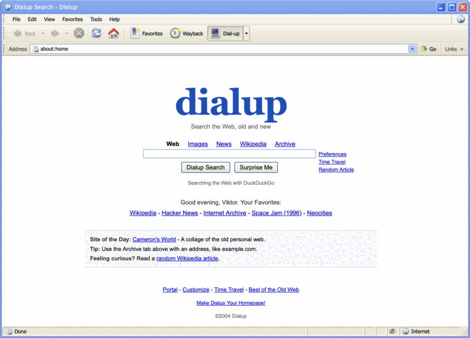
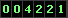

<h1 align="center"><br>Dialup</h1>

<p align="center">
  <a href="https://github.com/viktorfroberg/Dialup/releases/latest/download/Dialup.zip"></a>
  
  <a href="LICENSE"></a>
  
</p>

<p align="center">
  <a href="https://github.com/viktorfroberg/Dialup/actions/workflows/ci.yml"></a>
</p>

Dialup is a macOS browser with the look of the early 2000s: the XP title bar, the brushed-metal Mac toolbar, the grey bevels of Windows 98. Underneath it's modern WebKit, so today's web works fine.

<p align="center">
  
</p>

## Download

**[⬇ Download Dialup](https://github.com/viktorfroberg/Dialup/releases/latest/download/Dialup.zip)** for macOS 15.4 or later (Apple silicon and Intel). Or install from Terminal, without the security warning:

```sh
curl -fsSL https://raw.githubusercontent.com/viktorfroberg/Dialup/main/install.sh | sh
```

Dialup isn't notarized, so the zip needs **System Settings → Privacy & Security → Open Anyway** the first time. After that it updates itself.

## Features

- **Three skins:** Luna (XP), Aqua (Mac OS X) and Classic (Windows 98). Each is one CSS file.
- **Dial-up Mode** (⇧⌘D): pictures load at modem speed, "(3 items remaining)", 256 colours, old fonts.
- **A 2004-style start page**, tabs or one page per window, a Wayback button, ad blocking and synthesized sounds.

<p align="center">
  
</p>

## Build

```sh
brew install xcodegen && xcodegen generate
xcodebuild -project Dialup.xcodeproj -scheme Dialup -derivedDataPath build build
```

How it works, skinning, tests and the roadmap: [docs/DEVELOPING.md](docs/DEVELOPING.md). Releases: [docs/RELEASING.md](docs/RELEASING.md).

## Credits

Icons from the [Tango Icon Library](http://tango.freedesktop.org/) (public domain). Updates by [Sparkle](https://sparkle-project.org/). Skins are inspired by the era and contain no Microsoft or Apple artwork; the names mentioned are trademarks of their owners. [MIT license](LICENSE).

<p align="center">
  
  
  
</p>
