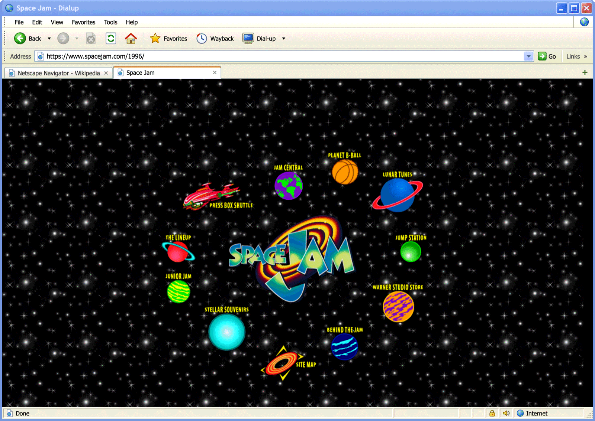
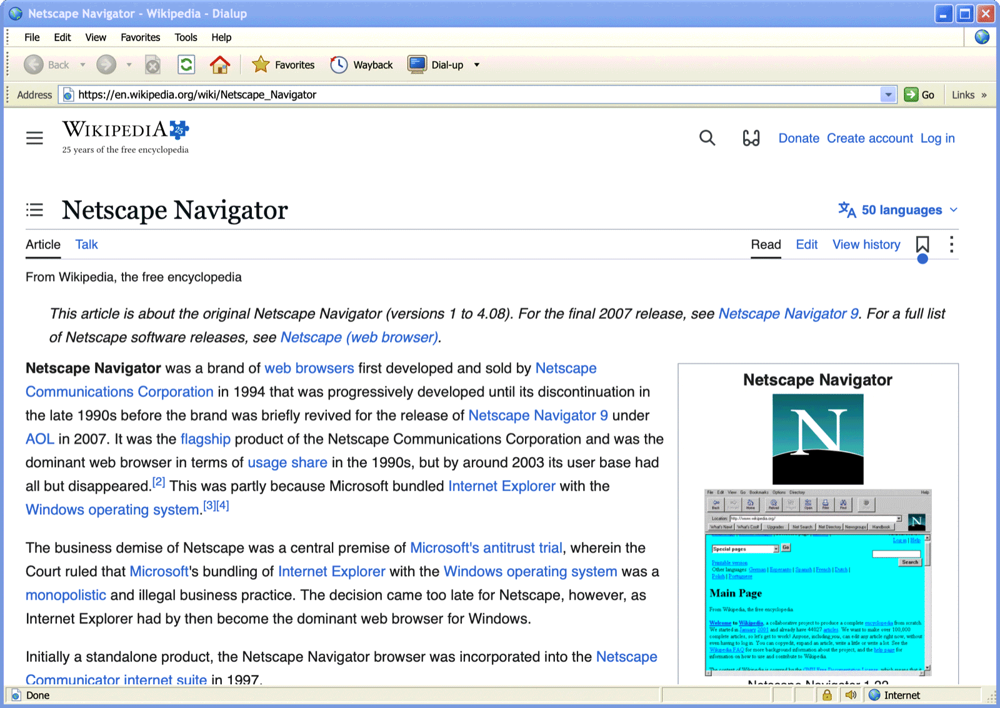
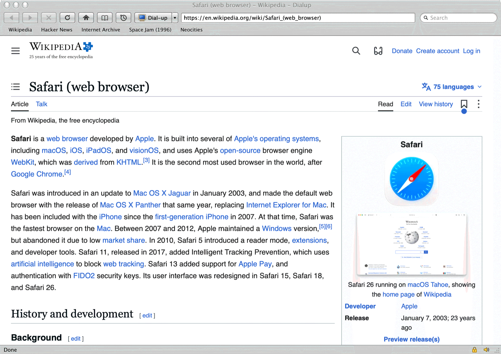
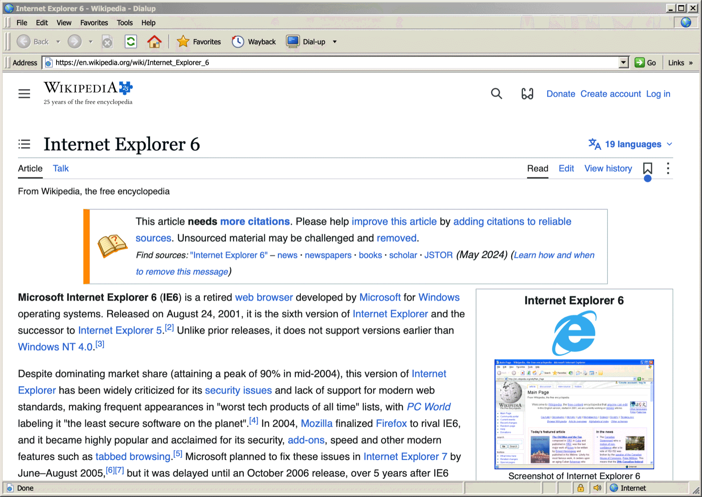
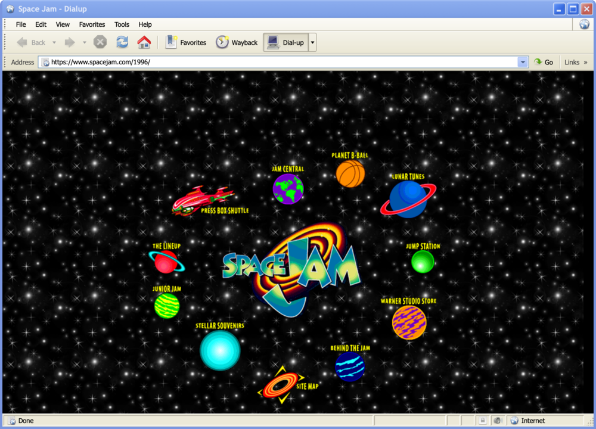
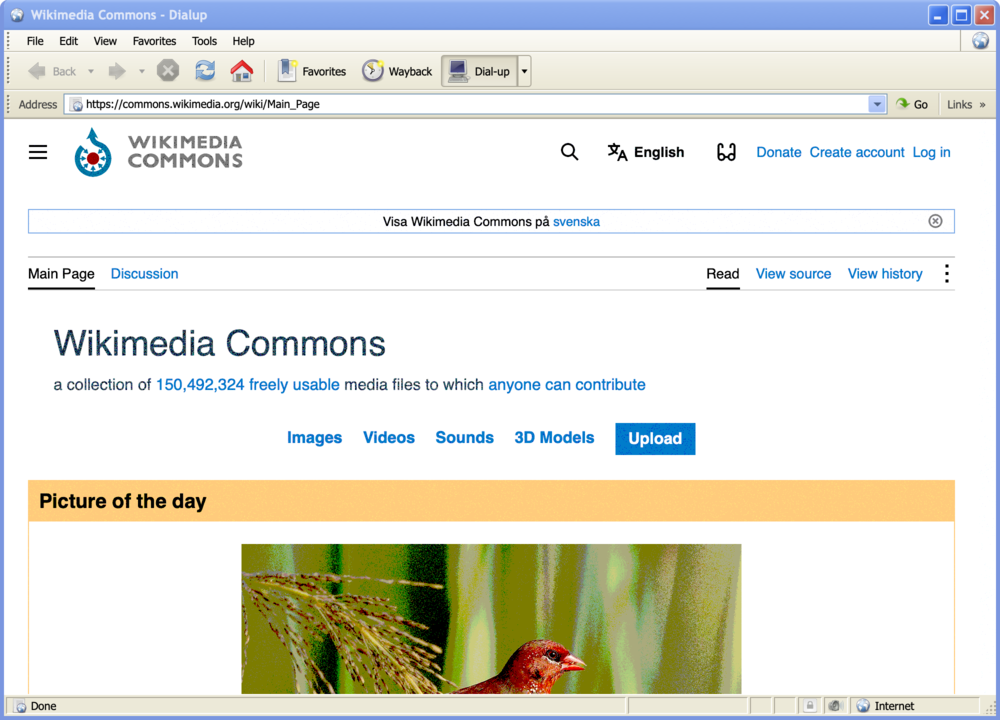
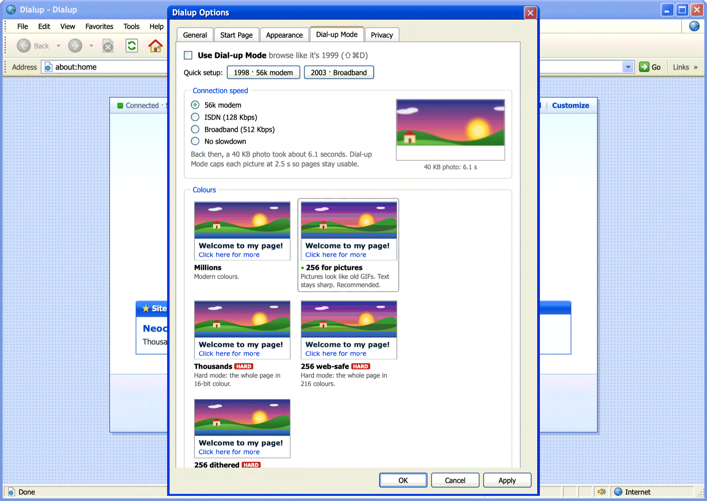
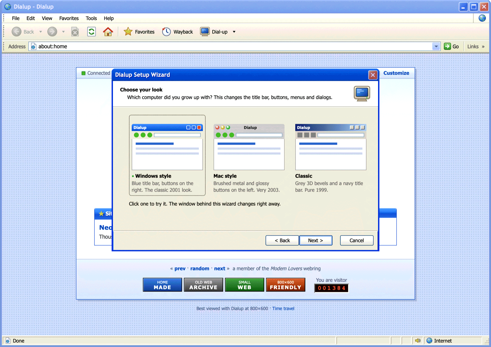
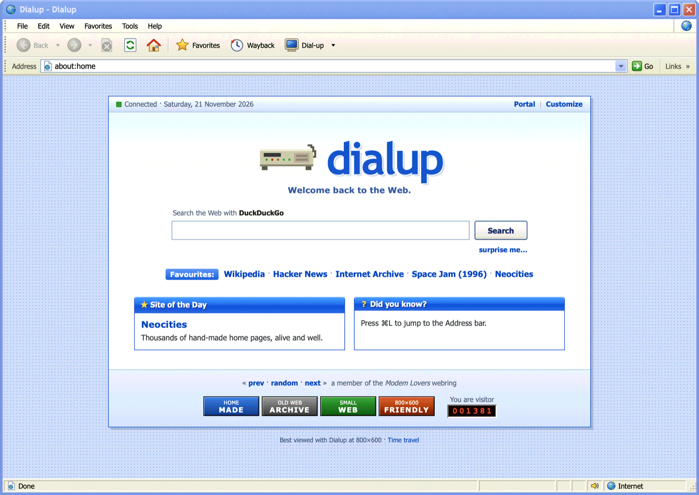
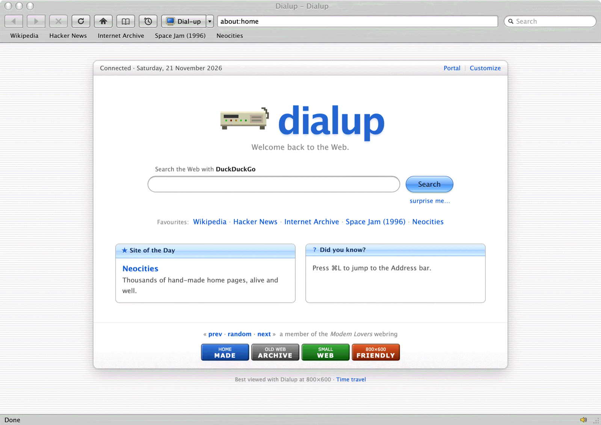

# Dialup

[](https://github.com/viktorfroberg/Dialup/actions/workflows/ci.yml)

Dialup is a macOS browser that looks and feels like the browsers of 2001–2004: the blue Windows XP title bar, the brushed-metal Mac toolbar, the grey 3D bevels of Windows 98. Underneath it's modern WebKit (the engine Safari uses), so today's web works fine. Turn on **Dial-up Mode** and pictures trickle in at modem speed while the status bar counts down "(3 items remaining)".

The whole browser UI is plain HTML and CSS, with no build step. A skin is one CSS file.

<p align="center">
  
</p>

<p align="center"><br><sub>The app icon follows your skin: the Tango globe on a tile in each skin's colours.</sub></p>

## Screenshots

<table>
  <tr>
    <td width="33%"></td>
    <td width="33%"></td>
    <td width="33%"></td>
  </tr>
  <tr>
    <td align="center"><b>Luna</b><br>Windows XP, 2001 (default)</td>
    <td align="center"><b>Aqua</b><br>Mac OS X, 2003</td>
    <td align="center"><b>Classic</b><br>Windows 98/2000</td>
  </tr>
</table>

<table>
  <tr>
    <td width="50%"></td>
    <td width="50%"></td>
  </tr>
  <tr>
    <td align="center"><b>Dial-up Mode</b>: pictures load at 56k speed, in GIF colours</td>
    <td align="center"><b>Hard mode</b>: the whole page in 216 dithered colours</td>
  </tr>
  <tr>
    <td></td>
    <td></td>
  </tr>
  <tr>
    <td align="center"><b>Dialup Options</b> (⌘,) with live previews</td>
    <td align="center"><b>Setup Wizard</b> on first run</td>
  </tr>
  <tr>
    <td></td>
    <td></td>
  </tr>
  <tr>
    <td align="center"><b>Start page</b>, hand-made at 800×600</td>
    <td align="center">…and it dresses up to match each skin</td>
  </tr>
</table>

## Features

- **Three skins.** Luna, Aqua and Classic each restyle everything: title bar, caption buttons, toolbars, menus, dialogs, tooltips, dropdowns and the status bar. The window itself is borderless, so the skin draws the whole frame, rounded XP and Aqua corners included.
- **Dial-up Mode** (⇧⌘D). Pictures load line by line at 56k, ISDN or 512k speed with a live "(n items remaining)" count. You also get a dial-in sequence, 256-colour "GIF" pictures, a faint CRT glow and scanlines, and old fonts. Hard mode puts the whole page in 16-bit or 216 web-safe colours, dithered if you like.
- **Retro page touches.** Classic scrollbars and square corners (on by default). No shadows, no animations and underlined links are opt-in.
- **Sounds.** Original synthesized clicks, a page-complete tick, error and ding, and a modem handshake. No samples taken from anywhere.
- **Tabs, or one page per window.** You choose in the wizard, like it's 2004. Session restore loads tabs lazily.
- **Wayback button.** Reload the current page as the Wayback Machine saw it in a year you pick.
- **Favorites.** Add to Favorites (⌘D), a Favorites menu and a Links bar (Aqua gets a bookmarks bar). Import and export the Netscape `bookmarks.html` format that every browser still understands.
- **A 2004-style start page** (`about:home`): a search engine front page with a wordmark, Web/Images/News/Wikipedia/Archive tabs, one big box and two buttons (one opens a random Wikipedia article). The portal-style page, with favorites, a webring and 88×31 buttons, is one click away.
- **Ad and tracker blocking** (on by default). Well-known ad and tracking networks are blocked with WebKit's native content rule lists, the engine Safari's blockers use. The domain list is Dialup's own.
- **Browser basics.** Downloads to ~/Downloads (never overwriting), file uploads, find in page (⌘F, ⌘G), zoom (⌘+ ⌘− ⌘0), print, JavaScript dialogs, mailto: and other links handed to the right app, and Dialup can be your default browser (Dialup → Make Dialup the Default Browser…).
- **Era details.** Padlock and certificate dialog, security zone in the status bar, throbber, address-bar combo dropdown, Back/Forward history menus.
- **Setup Wizard** on first run (Help → Setup Wizard… to see it again), and **Dialup Options** with visual previews of every Dial-up Mode setting.

## Download

**[Download Dialup for macOS](https://github.com/viktorfroberg/Dialup/releases/latest/download/Dialup.zip)** (macOS 15.4 or later, Apple silicon and Intel). Unzip it and drag Dialup.app to Applications. All versions are on the [Releases page](https://github.com/viktorfroberg/Dialup/releases).

Dialup is ad-hoc signed, not notarized by Apple, so macOS blocks it the first time. Try to open it once, then go to **System Settings → Privacy & Security**, scroll down and click **Open Anyway** (or run `xattr -dr com.apple.quarantine /Applications/Dialup.app`).

## Build & run

**Requirements:** macOS 15.4 or later, Xcode 16 or later (Swift 6), and [XcodeGen](https://github.com/yonaskolb/XcodeGen) via Homebrew.

```sh
brew install xcodegen                 # once
git clone https://github.com/viktorfroberg/Dialup.git
cd Dialup
xcodegen generate                     # creates Dialup.xcodeproj (not checked in)
xcodebuild -project Dialup.xcodeproj -scheme Dialup -derivedDataPath build build
open build/Build/Products/Debug/Dialup.app
```

Run the tests:

```sh
xcodebuild -project Dialup.xcodeproj -scheme Dialup -derivedDataPath build test
```

The tests run inside the app, but it opens no windows and leaves your saved session alone while they do. GitHub Actions runs the same build and tests on every push and pull request ([`.github/workflows/ci.yml`](.github/workflows/ci.yml)).

Or open `Dialup.xcodeproj` in Xcode and press ⌘R.

A build you make yourself opens without the Gatekeeper warning.

## How it works

```
DialupWindow (borderless and transparent; the skin draws the frame)
 └─ BrowserLayoutView
     ├─ Chrome WKWebView   dialup://chrome/index.html  (transparent; draws title bar, toolbars, status bar)
     ├─ Page WKWebView     the website, positioned inside insets the chrome reports
     └─ ScanlineView       Dial-up Mode CRT overlay (ignores clicks)
```

- **Host** (`Host/`, Swift 6): windows, native menus and shortcuts, focus, preferences, tabs, Dial-up Mode, ad blocking, sounds, bookmarks, downloads, and the bridge. Commands from the chrome are parsed into a typed `HostCommand`; tab order lives in a small, unit-tested `TabList`.
- **Chrome** (`Chrome/`, plain HTML/CSS/ES modules, no build step): everything you see around the page, plus the HTML menus and dialogs, Dialup Options and the wizard.
- **Start page** (`Start/`): static files served to pages as `dialup-start://home/`.
- **Bridge:** the chrome calls `host.call(cmd, args)`. The host pushes events back with `window.dialup.receive({event, data})`. See [docs/host-api.md](docs/host-api.md).
- **Menus that can cover the page:** while a menu or dialog is open, the host raises the transparent chrome web view above the page, so nothing gets clipped.

**The security boundary.** The browser UI and web pages never share a WebKit configuration. Pages get their own configuration with **no bridge** and **no `dialup://` scheme**, so a website can't call the host or load the chrome's files. The bridge only accepts messages from the chrome's main frame on `dialup://`. The scheme handler resolves symlinks before its folder check, and the chrome runs under a strict Content-Security-Policy (own files only, no remote scripts, styles or frames). The only extras injected into pages (a hover-link helper and the Dial-up Mode script) run in isolated content worlds. The start page's personal config is only served to the start page itself. Unit tests in `Tests/` check the bridge, scheme-handler and start-page rules.

## Make it yours

**Skins are CSS.** Each skin is one file in [`Chrome/skins/`](Chrome/skins/) (`luna.css`, `aqua.css`, `classic.css`) on top of `Chrome/base.css`. `base.css` declares the variables (`--face`, `--rebar-bg`, `--icon-back`…) and lists the class names in its header comment. Tweaking a built-in skin is just editing its CSS. Adding a brand-new skin today means copying one and adding a case to the `Skin` enum in `Host/App/Preferences.swift` (plus a few per-skin touches in the wizard and the page scrollbars in `Host/DialupMode/page-script.js`). Installable user skins from a folder are planned; see [docs/EXTENDING-PROPOSAL.md](docs/EXTENDING-PROPOSAL.md).

**Hack on the UI without Xcode.** The chrome runs in any browser with a fake host:

```sh
cd Chrome && python3 -m http.server 8000   # then open http://localhost:8000
```

Without a native host, `js/mock-host.js` stands in for it, so you can restyle the whole browser in Safari or Chrome: edit, reload, repeat, with devtools at hand.

**Inside the app**, use **View → Reload Chrome** (⌥⌘R) after editing files in the built app bundle. Both the chrome and pages can be inspected with Safari's Web Inspector (Develop menu).

**Debug snapshots** (debug builds only, like the `-HomePage` override) write the composited window to a PNG without Screen Recording permission. That's how the screenshots above were made:

```sh
build/Build/Products/Debug/Dialup.app/Contents/MacOS/Dialup \
  -DialupSnapshot ~/Desktop/dialup.png -DialupSnapshotDelay 6 \
  -HomePage "https://www.spacejam.com/1996/"
# add  -DialupChromeEval "<js>"  to run JavaScript in the chrome first (e.g. open a dialog)
```

**Docs:** [docs/host-api.md](docs/host-api.md) (chrome ↔ host bridge), [docs/PLAN.md](docs/PLAN.md) (architecture and plan), [docs/EXTENDING-PROPOSAL.md](docs/EXTENDING-PROPOSAL.md) (user skins, toolbars and add-ons). There's an index in [docs/README.md](docs/README.md).

## Roadmap

Next up, roughly in order:

1. Toolbar plugins in sandboxed iframes, with draggable rebar bands and Lock the Toolbars.
2. Explorer-style sidebars (Search, Favorites, History) and history storage.
3. Address autocomplete and a downloads window.
4. More skins (Platinum, Communicator-style) and user skins you can install without rebuilding.
5. A real throttling proxy for Dial-up Mode, a pop-up blocker with an information bar, WebExtensions.

See [docs/PLAN.md](docs/PLAN.md) for the full plan and [docs/EXTENDING-PROPOSAL.md](docs/EXTENDING-PROPOSAL.md) for how add-ons could work safely. What has shipped so far is in [CHANGELOG.md](CHANGELOG.md).

## Originality

The skins, sounds and start page are original, drawn or synthesized for Dialup. Toolbar and settings icons and the globe in the app icon come from the **Tango Icon Library** (public domain), real icons from the era by human artists. The skins are *inspired by* the look of the era. They don't contain any Microsoft or Apple artwork, and Dialup isn't affiliated with or endorsed by Microsoft, Apple, Netscape or anyone else. Windows, Windows XP, Internet Explorer, Mac OS X, Aqua, Safari and other names mentioned are trademarks of their respective owners. Websites in the screenshots belong to their owners.

## Credits

- **Icons:** [Tango Icon Library](http://tango.freedesktop.org/) 0.8.90 by the Tango Desktop Project artists, released into the public domain. Files are in `Chrome/img/tango/`.
- **Engine:** WebKit, via Apple's WKWebView.

## License

[MIT](LICENSE). Use it, fork it, reskin it. The Tango icons are public domain.
